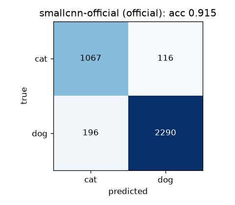
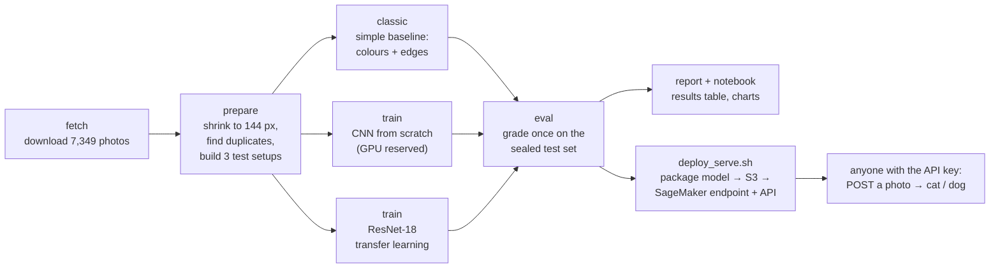

# Cat or dog? An honest image classifier, from laptop to AWS

A computer-vision project that teaches a computer to tell cats from dogs in photos, and is careful
about **how good it really is**. Built from scratch in PyTorch, with training on a local machine and
serving set up on AWS (SageMaker + API Gateway).

**New to machine learning?** Start with the [walkthrough notebook](notebooks/walkthrough.ipynb). It
explains every step in plain language, with pictures.

<!-- RESULTS -->
## Results

Cat vs dog, graded once on test photos the models never trained on. *Balanced accuracy* averages the
cat score and the dog score, so a model that always says "dog" scores 50%. All trained on a laptop CPU.

| Test | System | Balanced accuracy | Accuracy (95% range) |
|---|---|---|---|
| official | Simple baseline (colours + edges) | 68.8% | 70.2% (68.6–71.7%) |
| official | **Small CNN, from scratch** (30 epochs, ~35 min) | **91.2%** | 91.5% (90.5–92.3%) |
| official | **ResNet-18, transfer learning** (9 epochs, ~5 min) | **97.5%** | 97.2% (96.7–97.7%) |
| unseen-breeds | Simple baseline | 64.1% | 64.9% (62.8–66.6%) |
| unseen-breeds | Small CNN, from scratch | 87.2% | 87.5% (86.1–88.8%) |
| unseen-breeds | ResNet-18, transfer learning | 92.7% | 94.0% (93.0–94.9%) |
| *leaky-2023* | *Small CNN graded on its own training photos (the 2023 bug)* | *98.8%* | *98.7%* |

**What the numbers say**

- **The bug is worth 7 points.** The same small CNN scores 98.7% when graded on photos it studied,
  and 91.5% on photos it hasn't seen. A near-perfect score is a reason to check for leaks, not to celebrate.
- **Deep learning earns its place.** Hand-made colour and edge features reach 69%; a CNN learning
  its own features from pixels reaches 91% (from scratch) or 97.5% (transfer learning).
- **Unseen breeds cost 4–5 points**, and the misses aren't evenly spread. **Hairless Sphynx cats** are
  the hardest: both CNNs get only about 75% of them right, against 87–100% for every other unseen breed.
  A model that only ever saw furry cats has a reasonable doubt about a cat without fur.
- **Transfer learning wins, with a caveat:** ResNet-18 was pre-trained on ImageNet, whose 1,000
  categories include many of these breeds, so part of its edge is prior knowledge of them.


<!-- /RESULTS -->

## The story in one paragraph

In 2023 I tried this on Azure and stalled: the notebook ran out of memory, cloud costs crept up, and,
looking back at a screenshot, the code had a one-line bug, `train_loader = DataLoader(test_set)`.
The model was **studying the final exam**. This version starts over: it keeps the data small enough
for a laptop, gives every score an honest test, and serves the model through AWS so you can send it a
photo over the internet.

## What it does

1. **Looks at the data first:** 7,349 pet photos, 37 breeds, about twice as many dogs as cats.
2. **Hunts for hidden duplicates:** it fingerprints every photo and found **24 near-copies** that sit
   on both sides of the dataset's official training/test divide. Those are removed from training.
3. **Tries the simple approach before the fancy one:** hand-made measurements (colours, edge
   directions) fed into a classic statistical model.
4. **Trains two neural networks:** a small one built from scratch, and ResNet-18, a larger network
   pre-trained on millions of everyday photos (*transfer learning*).
5. **Tests three ways** (below), so the impressive-looking number and the honest one sit side by side.

## Three ways to grade a model

Think of training as studying, the **validation set** as practice quizzes (used to decide when to stop
studying), and the **test set** as the final exam, sealed until the end.

| Test | The "final exam" is… | Why |
|---|---|---|
| **official** | the dataset's own test half (3,669 photos), with duplicates removed from training | the standard, honest score |
| **unseen-breeds** | 12 breeds the model **never** saw (e.g. Sphynx cats, pugs, samoyeds) | does it understand "cat", or did it memorise breeds? |
| **leaky-2023** | the photos it trained on | reproduces the 2023 bug, to show what a cheating score looks like |

**Accuracy** is the share of photos labelled correctly. **Balanced accuracy** averages "how often it
gets cats right" and "how often it gets dogs right". That matters here: always answering "dog" would
already be right 68% of the time, but scores only 50% balanced.

## Workflow

Each box is one command. Left to right: get the data, check it, learn, grade, ship.



| Step | Command | Where it runs | Time |
|---|---|---|---|
| 1. Get the data | `python -m petcnn fetch` | your computer | ~1 min |
| 2. Check + split it | `python -m petcnn prepare` | your computer | ~10 s |
| 3. Simple baseline | `python -m petcnn classic --scheme official` | your computer | ~30 s |
| 4. CNN from scratch | `scripts/train_scratch_gpu.sh` (GPU only) or `train --arch smallcnn` (any) | GPU: minutes · CPU: ~30 min | |
| 5. Transfer learning | `python -m petcnn train --arch resnet18` | your computer | ~15–30 min on CPU |
| 6. Grade | `python -m petcnn eval --name <model>` then `report` | your computer | seconds |
| 7. Explain | `notebooks/walkthrough.ipynb` | your computer | — |
| 8. Ship | `deploy/deploy_serve.sh <model>` | AWS | ~10 min first time |
| 9. Clean up | `deploy/down.sh --all` | AWS | ~5 min |

Every push also runs two automated GitHub workflows: **ci** (the self-checks, a template lint and a
script syntax check) and **cloudburn** (a cost scan of the AWS templates).

**Can a CNN really be trained from scratch here?** Yes. The small CNN starts from random numbers and
learns only from these ~3,100 training photos, with no outside knowledge. That's harder than transfer
learning (ResNet-18 starts from a network already trained on millions of photos), which is exactly
why both are compared. The from-scratch run benefits most from a GPU, so
`scripts/train_scratch_gpu.sh` reserves it for the GPU: it refuses to start without one rather than
quietly crawling along on the processor.

## How it runs

```
            your computer                                      AWS
┌──────────────────────────────────┐        ┌───────────────────────────────────────────────┐
│ download → shrink to 144 px      │        │ S3 bucket: the trained model (model.tar.gz)   │
│ duplicate check → 3 test setups  │ upload │                    │                          │
│ train (CPU, or GPU if available) ├───────►│ SageMaker Serverless endpoint (scales to 0)   │
│ grade on the sealed test set     │        │                    ▲                          │
└──────────────────────────────────┘        │ API Gateway: API key, 2 req/s, 500/day cap    │
                                            │   (optionally at pets.willieman.com)          │
                                            └────────────────────▲──────────────────────────┘
                                                    photo ───────┘  → {"label": "cat", "confidence": 0.97}
```

- **Training happens locally.** At this size (7k small photos) a normal computer's processor is
  enough; a graphics card (GPU) makes it about 10× faster. The code uses one automatically when present.
- **Serving uses a SageMaker Serverless endpoint.** It starts up when a photo arrives and costs
  nothing while idle. The first request after a quiet spell can take ~30 s while it wakes up.
- **API Gateway** is the public front door. Callers need an API key, and a daily quota caps the bill.
- Costs are guarded by a $10/month AWS budget alert, resource tags, and a
  [CloudBurn](https://github.com/towardsthecloud/cloudburn) cost scan of the infrastructure on every change.

## Run it yourself

```bash
python3 -m venv .venv && source .venv/bin/activate
pip install torch torchvision --index-url https://download.pytorch.org/whl/cpu   # or a CUDA build
pip install -r requirements-dev.txt && pip install -e .
pytest -q                                    # quick self-checks, no internet or AWS needed

python -m petcnn fetch                       # download the photos (~800 MB)
python -m petcnn prepare                     # shrink, duplicate check, build the 3 test setups
python -m petcnn classic --scheme official   # the simple baseline
python -m petcnn train --arch smallcnn --scheme official
python -m petcnn eval --name smallcnn-official
python -m petcnn predict --name smallcnn-official my_pet.jpg
python -m petcnn report                      # results table
```

Deploy (needs an AWS account; see `CLAUDE.md` and `deploy/`):

```bash
ALERT_EMAIL=you@example.com deploy/deploy_cost.sh  # budget alert
deploy/deploy_lab.sh                               # S3 bucket + SageMaker role
deploy/deploy_serve.sh smallcnn-official           # endpoint + API; prints a ready-to-run curl
deploy/down.sh --all                               # tear it all down
```

## Project layout

```
config.yaml            every setting in one place (data, splits, training, AWS)
src/petcnn/            data.py (download, duplicates, splits) · preprocess.py · models.py
                       train.py · evaluate.py · features.py (baseline) · sagemaker.py
serve/inference.py     the code the SageMaker endpoint runs (also used by `predict`)
infra/                 CloudFormation: cost.yaml, lab.yaml, serve.yaml
deploy/                deploy and teardown scripts
notebooks/             walkthrough.ipynb (plain-language tour) + its builder script
results/               confusion matrices and the summary table
```

## Data and credit

[Oxford-IIIT Pet Dataset](https://www.robots.ox.ac.uk/~vgg/data/pets/): O. M. Parkhi, A. Vedaldi,
A. Zisserman and C. V. Jawahar, *Cats and Dogs*, CVPR 2012. CC BY-SA 4.0. Photos are downloaded
when you run the code, never stored in this repository. Images come via the
[Hugging Face copy](https://huggingface.co/datasets/timm/oxford-iiit-pet) (same files, faster
download); labels and the official split come from Oxford. See [PRIOR_ART.md](PRIOR_ART.md) for how
this compares with popular public notebooks.

## Where this goes next

- The 37-breed version of the task (much harder than cat vs dog).
- Larger images on a GPU; a look at the model's most confident mistakes.
- A small web page at pets.willieman.com: upload a photo, get an answer.

Code: MIT license.

Deployment record (2026-10-21: deployed, tested, torn down): [docs/DEPLOYMENT.md](docs/DEPLOYMENT.md)
